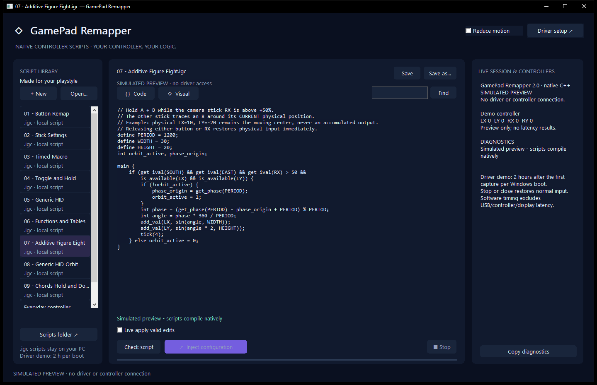
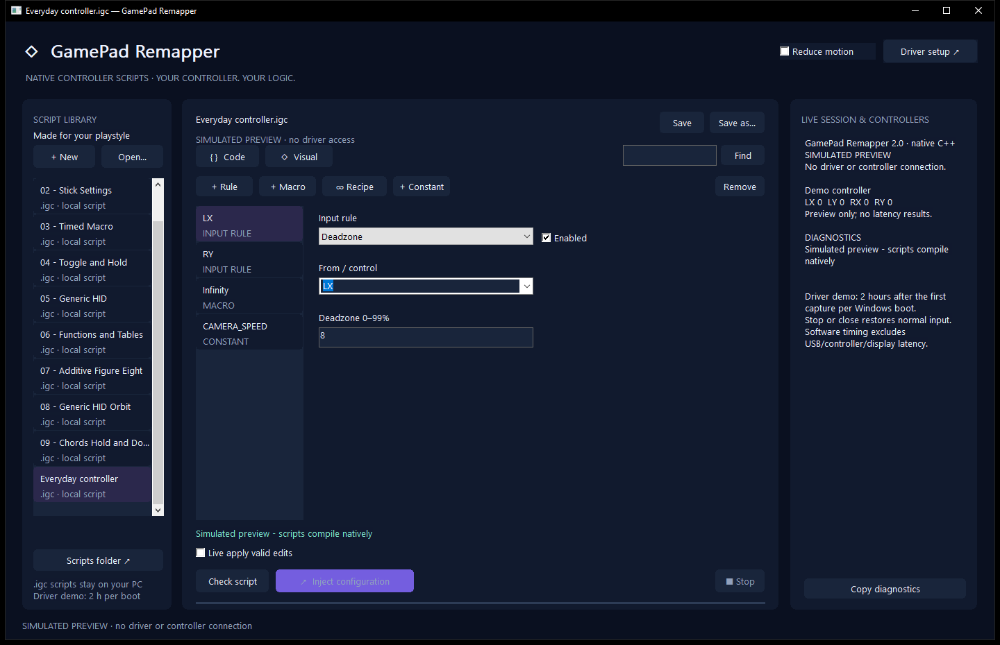
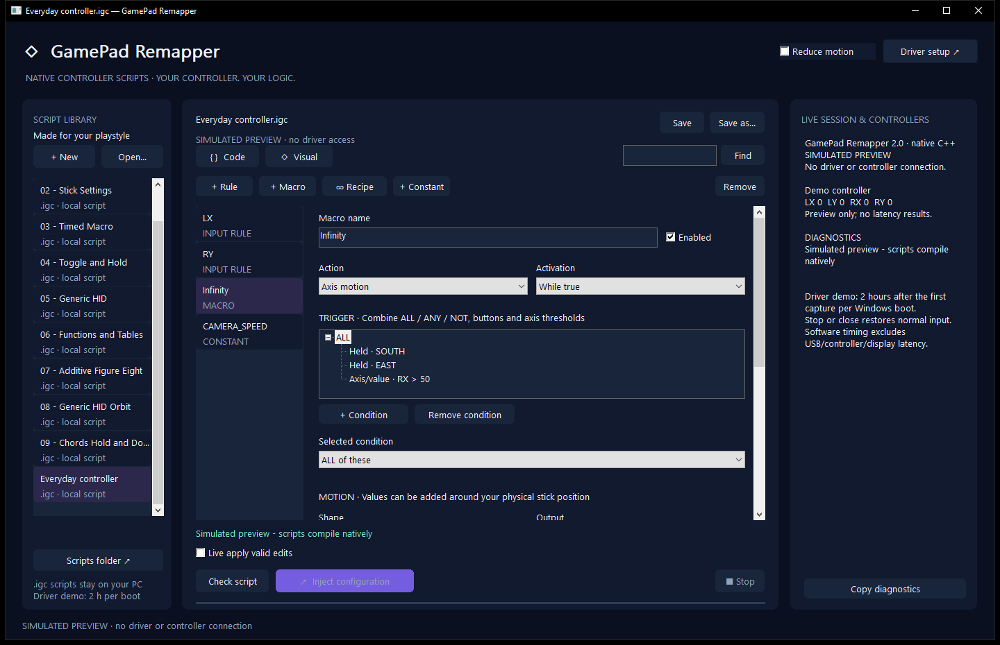

# GamePad Remapper — Native C++ Controller Scripting & Macros

A desktop editor for controller remapping, compound triggers, continuous motion
and timed macros in **`.igc` scripts**,
powered by [Interceptor Gamepad & Controller](https://github.com/TitanCSA/Interceptor-Gamepad-Controller),
a Windows Kernel Filter Driver for HID, XInput/XUSB, XInputHID and GIP input.

**[Download](https://github.com/TitanCSA/GamePad-Remapper/releases/latest)** ·
[IGC language](docs/LANGUAGE.md) · [Build](docs/BUILD.md) · [Test results](docs/VALIDATION.md)

| Write code | Edit visually |
| --- | --- |
|  |  |

Screenshots show the real native Windows interface with explicitly simulated controller
activity. Normal use displays actual driver state and never invents devices.

<details>
<summary>Macro designer</summary>



</details>

## One script, two views

- **Code:** a C-like language with `init`, `main`, variables, arrays, functions,
  conditionals, loops, arithmetic, input events and timed `combo` sequences.
- **Visual:** remap and axis cards; nested **ALL / ANY / NOT** triggers, holds,
  double taps and axis thresholds; timed sequences or figure-eight, circle and
  sine motion. Add the ready-to-edit infinity recipe with one click.
  Advanced code is preserved when switching views.
- **Library:** create, open and save `.igc` files; atomic saves keep the previous
  version as `.bak`. Unsaved edits get recovery drafts. Saved scripts are
  available from the sidebar.
- **Inject configuration:** compile and apply behavior to captured controllers.
  **Stop** releases capture. Applying a script updates user-mode behavior; it
  does not load script code into the kernel or flash controller firmware.
- **Fewer clicks:** automatic background validation, readable behavior summaries,
  connected controls first in selectors, and optional **Live apply valid edits**.
  Invalid edits keep the last working configuration.
- **Monitor:** actual controller activity, forwarding counts, measured processing
  time and copyable diagnostics. The UI runs separately from the input worker.

## Start

Windows 10/11 **x64**. Native C++ application, with no .NET dependency.

1. Download and extract `GamePad-Remapper-2.0.0-win-x64.zip`. The application is a single native C++ EXE.
   The ZIP includes example scripts and the driver installer; no .NET runtime or application DLLs are needed.
2. Run **`InterceptorSetup.exe`** and install **Interceptor Gamepad & Controller**.
   If requested, use Windows **Restart**, then reopen the installer to complete
   device associations. See the [driver installation instructions](https://github.com/TitanCSA/Interceptor-Gamepad-Controller#quick-start).
3. Open **`GamePadRemapper.exe`**. Select an example or create a script. Editing
   and compiling work without an installed driver or administrator rights.
4. Edit in **Code** or **Visual editor**, then choose **Inject configuration**
   (**Ctrl+Enter**).
   Approve Windows elevation when requested: the driver restricts capture to
   administrators. Starting a capture does not require moving a controller.
5. Use **Stop** before another capture application. Closing this app also
   releases capture and restores physical input passthrough.

Your library is stored in `Documents/GamePad Remapper/Scripts`. You can open
`.igc` files from any folder. Enable **Live apply valid edits** once per session
to apply subsequent valid changes after a short editing pause. It only updates
an already-running capture; opening a file or enabling the option never starts
capture. **Ctrl+S** saves the script; recovery drafts do not replace that file.

## Complex behavior without a complex setup

In **Visual editor**, choose **∞ A + B → additive figure eight**, then
**Inject configuration**. The recipe holds A + B (`SOUTH` + `EAST`) and checks
that camera `RX > 50%`; it adds an infinity motion to `LX` / `LY` while that
condition remains true. Adjust the two axes, width, height and cycle directly
on the card. Generic HID controllers need their reported `BUTTON_n` / `AXIS_n`
bindings instead of assumed button labels.

With physical `LX = 10%` and `LY = -20%`, those values are the moving center.
Each evaluation starts from current physical input and adds the motion once:
there is no accumulated drift. Moving the stick moves that center; releasing
either button or dropping `RX` to `50%` stops the recipe on the next received
input. Output stays within the axis limits. **Replace** can instead follow
physical input, hold the position at activation, or use `(0, 0)` as its center.

Combine nested conditions, custom expressions, stateful functions and combos
for other behaviors. Sequences support activation, repeat-while-true,
deactivation and toggle modes; steps can **Add** or **Replace**. The code view
remains available for logic beyond the visual cards.

<details>
<summary>The same additive figure eight as an IGC script</summary>

```c
define PERIOD = 1200;
int active, origin;

main {
    if (get_ival(SOUTH) && get_ival(EAST) && get_ival(RX) > 50 &&
        is_available(LX) && is_available(LY)) {
        if (!active) { origin = get_phase(PERIOD); active = 1; }
        int phase = (get_phase(PERIOD) - origin + PERIOD) % PERIOD;
        int angle = phase * 360 / PERIOD;
        add_val(LX, sin(angle, 30));
        add_val(LY, sin(angle * 2, 20));
        tick(4);
    } else active = 0;
}
```

`sin` uses degrees and returns an integer scaled by its second argument.
`add_val` composes with existing output; with no earlier transform, that is the
physical stick. `get_phase` uses monotonic time, so phase does not drift when
Windows delivers a late tick. `tick(4)` requests updates only on this active
path. See [the complete example](Scripts/07%20-%20Additive%20Figure%20Eight.igc)
and [generic HID version](Scripts/08%20-%20Generic%20HID%20Orbit.igc).

</details>

## A small IGC script

```c
define TAP_MS = 80;

main {
    // Native XInput / GIP controls. HID uses descriptor-based names below.
    if (is_available(LY)) invert(LY);
    if (event_press(SOUTH)) combo_run(DoubleTap);
}

combo DoubleTap {
    set_val(EAST, 100); wait(TAP_MS);
    set_val(EAST, 0);   wait(TAP_MS);
    set_val(EAST, 100); wait(TAP_MS);
    set_val(EAST, 0);   wait(TAP_MS);
}
```

For a generic HID controller, use the displayed **`BUTTON_1`, `AXIS_1`,
`TRIGGER_1`, `HAT_1`** and other descriptor-based controls. HID button usages do
not universally identify A/Cross or B/Circle, so the app does not guess a brand
layout from a product name. Only controls actually present on that controller
can be changed. Script state is independent for each captured device. Wide
binary fields and proprietary features outside the descriptor/protocol remain
unchanged; arbitrary vendor checksums and hardware features are not emulated.

IGC is an original language **inspired by GPC**, not the Cronus compiler or a
drop-in implementation of every GPC firmware API. The
[language reference](docs/LANGUAGE.md) describes supported syntax, timing,
identifiers, limits and differences. Hardware-specific Cronus display, console
authentication and device APIs are not simulated.

## Driver compatibility and demo

Support comes from the connected controller's **driver stack, descriptor and
protocol**, including supported DS4/DualShock 4, DualSense, wired Xbox 360 and
Xbox One/Series profiles. A matching brand name alone is not a compatibility
guarantee. Unsupported bytes pass through unchanged. See the
[driver compatibility guide](https://github.com/TitanCSA/Interceptor-Gamepad-Controller/blob/main/docs/COMPATIBILITY.md).

The signed driver is a **two-hour demo per Windows boot**, starting at the first
successful capture and shared by applications using this driver edition.
Closing or reinstalling does not reset it. At expiry, captures are revoked and
physical input passes through normally. Use Windows **Restart** for a new
allowance. For the unrestricted driver, DM **`titancsa`** on Discord.

The remapper is open source under [MIT](LICENSE). Driver binary terms are
[separate](DRIVER-BINARY-LICENSE.txt). The release includes the unmodified
Microsoft-signed driver installer; the driver signature does not sign the
remapper EXE. Kernel driver source and signing credentials are not published.

## Performance and reliability

Scripts compile once to bounded bytecode. A dedicated worker processes input
outside the UI thread; timed work uses one-shot timers, and an idle script does
not require a busy polling loop. The runtime limits instructions, stacks and
arrays. Script faults release capture rather than keep a broken transform active.

No software can promise zero latency or universal hardware support. Measured
software costs, stress tests and signed-driver VM tests are recorded with their
scope in [validation](docs/VALIDATION.md).

Built by **TitanCSA**, using the independent
[Interceptor Gamepad & Controller](https://github.com/TitanCSA/Interceptor-Gamepad-Controller)
project and the interception workflow popularized by
[oblitum/Interception](https://github.com/oblitum/Interception). No affiliation with
Cronus, oblitum, Microsoft, Sony or other controller manufacturers.

## Source layout

Only four content folders:

```text
App/          C++ application, UI, script engine, capture, tests and build tools
Scripts/      Ready-to-edit .igc examples
docs/         Documentation and screenshots
Interceptor/  The original two-file C++ user-mode SDK
```

Everything in the application is **C++17**, including the editor, visual model,
compiler and runtime. Capture and the SDK are linked directly into the EXE.
Build with `./Build.ps1`; generated files stay inside ignored `App/.build/`.
See the [build instructions](docs/BUILD.md).
