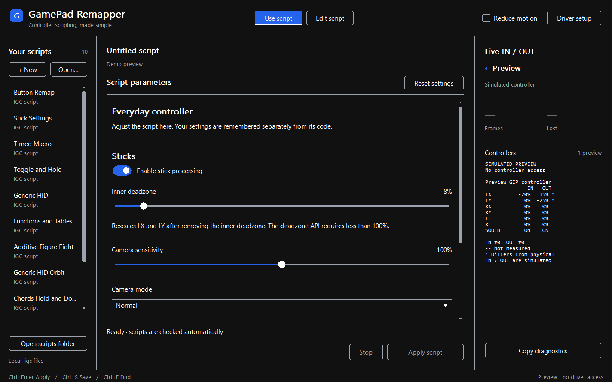

# Live IN / OUT debugging

The inspector uses controller tabs and aligned IN/OUT rows. The bundled **1.0.11.0-demo** Gamepad & Controller installer supplies the Microsoft-signed kernel **1.0.11.0** and resident demo clock; capture SDK **1.0.4.2** remains compatible.

Open the application and approve the Windows administrator prompt if shown.
Observation starts automatically; there is no enable button. Nothing needs to
be loaded or applied. After a monitor failure, reconnection is retried at most
once every three seconds by the existing health timer. Successful observation
uses no retry polling. The monitor remains active after **Stop**, a script error
or a failed capture. Editing remains available if the driver is missing; offline
preview and script-check commands need no elevation. Starting observation does
not apply a script. A monitor subscription starts the shared two-hour trial;
observation and remapping stop at expiry. Closing the app does not reset it.
Use Windows Restart for a new allowance.

| Column | Measurement |
| --- | --- |
| **IN** | A report received on this filtered controller stack, before changes made at that layer. |
| **OUT** | A successful report completion from the filter towards Windows, after any modification. |

Select a **controller tab** above the inspector. Selection stays on the same
device when its values change, and the view keeps each control in a fixed row.
Only the selected device is displayed. Use the scrollbar or keyboard navigation
to reach additional controls, and drag the divider to give the inspector more
space. Selecting another tab does not change capture or the running script.

The columns show each available control side by side: button states, axis
percentages and bars, triggers, hats and other decoded controls. **Blue OUT**
marks a difference from a known IN value; **—** means that direction has not
been measured. HID controls come from their own descriptor; multiple reports
and repeated axis usages stay distinct. Native XUSB/GIP states include partial
Guide updates where available. A translated HID view is labeled by its family:
it is a Windows-derived report, not another independent electrical USB
measurement. One physical controller can expose more than one filtered
collection or transport view.

A quiet device keeps its last measured value and timestamp; an error or lost
report never becomes a fabricated neutral state. Value changes repaint the
affected area without rewriting the entire text view or moving neighboring
rows. Numeric fields have fixed positions and update directly: measured values
are never eased, interpolated or delayed for interface animation.

**Copy diagnostics** includes device identity, raw bytes, IN/OUT sequence numbers,
QPC timestamps and age, Windows/driver failures and lost-report counts. A slow
monitor can lose records from its bounded ring without blocking input delivery.
Observation uses a read-only control handle and per-device HID readers, not an
interception context. It does not suppress, synthesize or remap controller input.

Capture and observation run separately from UI painting. Changed snapshots wake
the UI without a fixed FPS timer. Actual report rates still depend on the device,
Windows scheduling and display refresh. OUT is the report submitted at a successful
driver completion, not a guarantee that a particular game, browser or API read it.
Several Windows HID readers can produce several OUT completions for one IN;
their queues may also have different ages. These counts are not controller FPS.
Control hover, press and toggle animations last about 120 ms and stop when
settled. They respect Windows' animation preference and **… → Reduce interface
motion**; the input measurements themselves do not animate.

To debug a script, compare IN with OUT before applying it, apply the script,
then press **Stop** and compare again. Continue moving the controller after Stop:
the monitor remains live and normally shows matching passthrough values.
